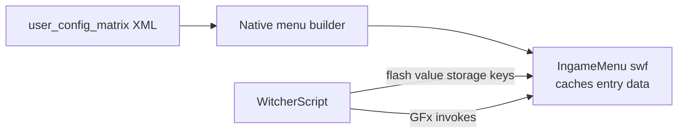

# Flash menus: constraints

Findings from dynamic slider notch impl.

## Architecture

## Notes

1. Options panel entries are built natively from the config XML. `CR4IngameMenu.showOptionsPanel` and `IngameMenu_FillOptionsSubMenuData` appear to be dead code (inserting logging into the base game scripts yields nothing).
2. The option list is rebuilt from `OptionListModule.optionListData` whenever `options.update_disabled` or `options.force_update_values` is sent.
   - To replace an entry permanently, edit it in `optionListData`.
3. Sliders can get stuck to the mouse cursor after a drag. Triggered by attempting these after the menu has opened:
   - running `remove_entry` / `insert_entry`
   - rebuilding the panel
4. Keyboard/gamepad appear to work without issue.
5. `m_fxUpdateOptionLabel` and `m_fxRemoveOption` target main menu entries, not option rows (vanilla uses: `toggle_render` caption,`Continue`/`LoadGame` removal).
6. Direct GFx invokes did not appear to trigger a rebuild. They may be a safe channel if a row-targeted invoke is found in the swf.
